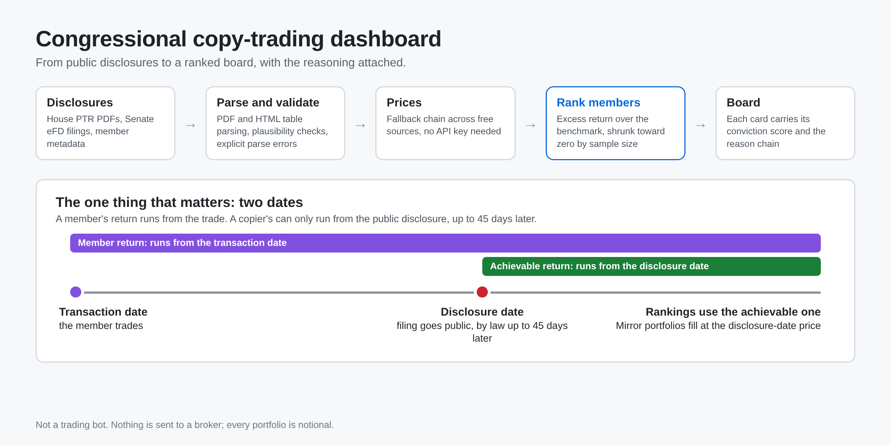

# Congressional copy-trading dashboard

Tracks what members of Congress disclose buying, works out whose trades are
actually worth following, and tells you what to look at now — with the
reasoning attached.

It is not a trading bot. Nothing is ever sent to a broker, and no order is
placed. Portfolios here are notional: they answer "if I had copied this
person, where would I be?"

Everything runs at **zero cost with no API key**.



## Disclaimer

This project is for educational and research purposes only. It is not
investment advice, and nothing in it places orders: no broker is connected and
every portfolio is notional. Disclosures are public records that arrive weeks
after the trades they describe, and past results do not predict future ones.
Use it at your own risk.

---

## The one thing that matters

A disclosed trade has two dates, and conflating them is how a copy-trading
dashboard ends up lying to you:

- **Transaction date** — when the member actually traded.
- **Disclosure date** — when the filing went public, by law up to 45 days
  later.

The member's return runs from the first. Yours can only run from the second.
The gap averages several weeks and is routinely the difference between a
member's spectacular trade and a copier's mediocre one.

So: member returns and achievable returns are computed and shown separately,
member rankings are built on the achievable one, and mirror portfolios fill
at the disclosure-date price. A sell only ever closes what a watchlist
actually holds, so a portfolio cannot realise gains on a position it never
opened.

Rankings shrink each member's average excess return toward zero by sample
size, so four lucky trades don't outrank forty consistent ones.

---

## Where the data comes from

| What | Source | Cost |
|---|---|---|
| House transaction reports | `disclosures-clerk.house.gov` year archive → PTR PDFs | free |
| Senate transaction reports | `efdsearch.senate.gov` (needs Chrome TLS impersonation) | free |
| Member party, photo, bioguide | `unitedstates/congress-legislators` | free |
| Daily prices | Nasdaq public API → Stooq → Yahoo → Twelve Data | free |
| News, per member / ticker / figure / world | Google News RSS | free |
| Sentiment | built-in finance lexicon, no model download | free |

The community JSON mirrors everyone used to use (House/Senate Stock Watcher)
now refuse anonymous reads, so ingest goes to the primary source. House PTRs
are PDFs; `disclosures.parse_ptr_text` reads their transaction tables and
handles the awkward parts — small-caps form labels that extract as NUL bytes,
asset names wrapping across three lines, the type code butting straight
against the transaction row, and multi-line free-text descriptions that would
otherwise bleed into the next row's asset name. Measured over 60 real
filings: 651 transactions, 87% with a resolvable ticker.

**The Senate needed a different key.** `efdsearch.senate.gov` sits behind an
edge WAF that fingerprints the TLS handshake rather than the headers: httpx
and curl are refused with a blanket 403 from every network, residential
included, while Chrome on the same machine and IP loads it fine. `curl_cffi`
replays Chrome's TLS fingerprint, which is what makes Senate coverage
possible at all. The reward is that Senate filings are far better structured
than the House's — an HTML table with a ticker column, rather than a PDF.

**One gap remains, surfaced rather than hidden.** A minority of members file
on paper; those scans have no text layer and are recorded with an explicit
parse error, listed on the Data page rather than quietly dropped.

---

## Quick start

```bash
uv sync
uv run trade-bot refresh      # first run downloads and parses filings
uv run trade-bot serve        # http://127.0.0.1:8765
```

The status bar at the top of every page streams what the app is doing right
now — which filing it is parsing, which price it is fetching — over SSE.

Runtime data (filings, prices, OCR reads, reports, the SQLite database) is
created under `var/` as needed. That directory is not part of the repository and
is safe to delete; it rebuilds on the next refresh.

Set `TRADE_BOT_DISCLOSURES__USER_AGENT` to a string that identifies you
(project name plus a contact address you control) before scraping at any
volume. The SEC and the disclosure sites ask clients to identify themselves.

To host your own copy (container, Postgres, scheduled refresh, static
snapshot), see **[DEPLOY.md](DEPLOY.md)**.

---

## The pages

- **Board** — what to look at now. Each card carries its conviction score and
  the reason chain behind it: who bought, their record, how stale the
  disclosure is, what the stock has done since, coverage tone, political
  mentions, and any members selling the same name.
- **Members** — the leaderboard, by shrunk excess return over the benchmark.
- **Member detail** — every disclosure with member vs copier vs benchmark
  return side by side, plus their recent news.
- **Trades** — the raw disclosure feed, filterable.
- **Ticker** — who traded it, the price line, headlines and mentions.
- **Watchlists** — mirror a member into a notional portfolio and track PnL.
- **Politics** — companies named in coverage of tracked figures, each with the
  confidence and the matched terms that produced it.
- **News** — everything ingested, sentiment-scored.
- **Digest** — what became public since the last run, filtered to top-ranked
  members and clustered activity. Also written to `var/reports/` and to the
  scheduled run's job summary, so the product does not require a visit.
- **Data** — what was ingested, from where, what failed, and what does not
  look right: the plausibility stage reports implausible reporting lags,
  price series that look unadjusted, prose where a company name should be,
  duplicate lots, and any source that reported success while changing
  nothing.

---

## Command line

```bash
trade-bot refresh                     # the whole pipeline
trade-bot refresh --stage prices --stage board
trade-bot validate                    # is the stored data plausible?
trade-bot repair                      # deterministic fixes; --apply to write
trade-bot sync house --year 2026 --limit 50
trade-bot members top                 # the leaderboard
trade-bot board                       # opportunities, with reasoning
trade-bot watch create "Top performers" --member house-fl-moskowitz-jared
trade-bot watch list
trade-bot export --out dist           # static snapshot
trade-bot agents --install            # keep the local server and tunnel alive
trade-bot status
```

Every command drives the same modules the dashboard does — there is no
CLI-only code path, and no web-only one.

---

## Conviction, and what it isn't

The board ranks **both directions**. Cluster selling ahead of a fall is the
same evidence read the other way, and it measures stronger: sales beat the
index 56% of the time over 90 days against 45% for purchases.

The score is a weighted blend, each part normalised to roughly 0..1:

| Weight | Signal |
|---|---|
| 0.62 | best track record among the members on this side, at *that direction* (shrunk) |
| 0.12 | recency of the disclosure |
| 0.08 | how many distinct members acted within a quarter of each other |
| 0.06 | disclosed dollar size |
| 0.12 | recent news sentiment, read in the direction of the trade |
| +0.20 | political attention, scaled by how many mentions |
| +0.14 | committee overlap — **sell cards only** |

Members going the other way on the same name are counted on the card and
**do not** damp it. They used to, by up to 45%; measured over 678 past
positions, purchases with nobody selling returned −0.25% and those with two or
more sellers against them +3.82%. The penalty was removed rather than
reversed — a bonus would be fitting one window — and `/evidence` re-tests
whether the blend orders outcomes on every run.

That last row is there because it was measured rather than assumed. A member
trading a company their committee oversees was expected to be the strongest
signal congressional data can produce. Over three years at the 90-day horizon:

| | median vs index | beat rate |
|---|---|---|
| purchases inside the member's remit | −2.71% | 40% |
| purchases outside it | −1.57% | 45% |
| sales inside the member's remit | +3.19% | 63% |
| sales outside it | +1.75% | 56% |

So it earns weight on sells and none on buys. Committee membership is still
shown on every card — it is a reason to read a disclosure closely — it just
does not move the buy-side number. The measurement is recomputed every run
and published on `/evidence`.

This ranks *newly public information*, not fresh trades — the reporting lag
is shown on every card precisely so that limitation stays in view. Treat it
as a reading list, not a signal.

**This is not financial advice, and none of it is a recommendation to buy or
sell anything.**

---

## Optional extras

```bash
uv sync --extra ml         # pooled LightGBM trade-edge model
uv sync --extra postgres   # Supabase/Postgres instead of local SQLite
```

The edge model trains one classifier across *every* member's trades — per
member the data is far too thin — predicting whether a disclosure beats the
benchmark, using only features known at disclosure time. Each member's own
prior record is a feature, computed on an expanding window so no trade is
ever scored using its own outcome. Without the extra installed, ranking is
purely statistical and everything still works.

---

## Tests

```bash
uv run pytest        # 317 tests
uv run ruff check src tests
uv run mypy
```

The suite covers the PTR parser against real filing quirks, the member/copier
return distinction, shrinkage, the mirror rules that stop a portfolio
inventing gains, sentiment's negation scoping and policy-word neutrality,
ticker extraction against English words that are also tickers, and every
dashboard route.

---

## License

MIT. See [LICENSE](LICENSE).
